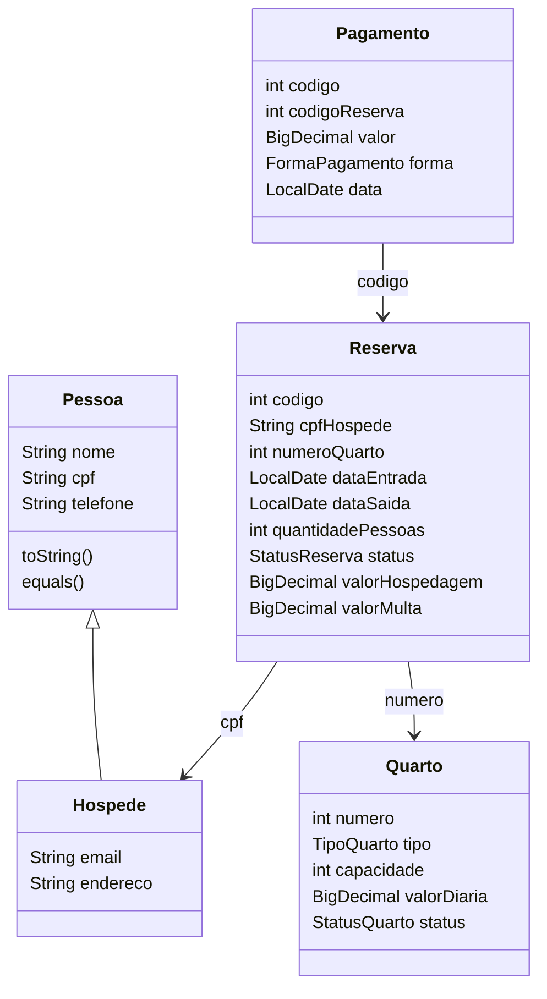

# Especificação do sistema de reservas da pousada

A recepção cadastra hóspedes e quartos, abre reservas, lança pagamento no balcão, faz check-in e check-out. O sistema calcula hospedagem, multa e saldo. Ao fechar e abrir de novo, os cadastros voltam dos arquivos de texto da pasta `dados` (`hospedes.txt`, `quartos.txt`, `reservas.txt`, `pagamentos.txt` e `sequencia.txt`). Dá para abrir esses arquivos no Bloco de Notas.

Não há nota fiscal, pagamento online, estorno automático nem mais de um quarto na mesma reserva.

## Requisitos

1. Incluir, listar, buscar, alterar e excluir hóspede. CPF com 11 dígitos e único. Nome com pelo menos 3 caracteres. Telefone com 10 ou 11 dígitos.
2. Incluir, listar, buscar, alterar e excluir quarto. Número único. Tipos: simples, duplo, suíte e chalé. Quarto em manutenção não entra em reserva nova.
3. Incluir, listar, buscar, alterar e cancelar reserva. A entrada não pode ser anterior a hoje. A saída é depois da entrada. O período não pode cruzar outra reserva confirmada ou em check-in do mesmo quarto.
4. Check-in só com reserva confirmada e quarto disponível. O quarto fica ocupado.
5. Check-out só com reserva em check-in. Só conclui quando o saldo em aberto é zero. Saída atrasada cobra, por dia extra, a diária da reserva mais 50%.
6. Lançar pagamento em dinheiro, Pix ou cartão, sem ultrapassar o saldo. Vários pagamentos podem quitar a mesma reserva.
7. Multa de cancelamento, só em reserva confirmada: 0% com 7 dias ou mais de antecedência, 30% de 3 a 6 dias, 50% com menos de 3 dias.
8. Toda entrada inválida mostra a mensagem e o programa continua.
9. Os dados ficam em arquivo e são recuperados na próxima execução.

## Mockups das telas

A interface é o console. Cada bloco abaixo é a tela que a recepção vê.

### Menu principal

```text
Sistema de reservas da pousada
Dados em: ...\trabalho_java\dados

=== Menu principal ===
1 - Hóspedes
2 - Quartos
3 - Reservas
4 - Pagamentos
0 - Sair
Opção:
```

### Cadastro de hóspede

```text
=== Hóspedes ===
1 - Incluir
2 - Listar
3 - Buscar
4 - Alterar
5 - Excluir
0 - Voltar
Opção: 1
Nome: Ana Souza
CPF: 52998224725
Telefone: 11987654321
E-mail (Enter para vazio): ana@email.com
Endereço (Enter para vazio): Rua das Flores, 10
Hóspede incluído.
```

### Nova reserva

```text
=== Reservas ===
1 - Incluir
2 - Listar
3 - Buscar por código
4 - Alterar
5 - Cancelar
6 - Check-in
7 - Check-out
0 - Voltar
Opção: 1
CPF do hóspede: 52998224725
Número do quarto: 101
Entrada (dd/MM/aaaa): 24/11/2026
Saída (dd/MM/aaaa): 26/11/2026
Quantidade de pessoas: 1
Reserva confirmada.
Reserva 1 | quarto 101 | 24/11/2026 a 26/11/2026 | hospedagem R$ 300,00
```

### Pagamento e saldo

```text
=== Pagamentos ===
1 - Lançar pagamento
2 - Consultar saldo da reserva
0 - Voltar
Opção: 1
Código da reserva: 1
Valor: 100,00
Forma de pagamento:
1 - Dinheiro
2 - Pix
3 - Cartão
Opção: 2
Pagamento lançado.
Hospedagem: R$ 300,00
Multa: R$ 0,00
Pago: R$ 100,00
Saldo em aberto: R$ 200,00
Situação: Parcial
```

### Check-out com multa de atraso

```text
Código da reserva: 1
Data real de saída (dd/MM/aaaa): 28/11/2026
Atraso de 2 dia(s). Multa: R$ 450,00.
Check-out não concluído. Quite o saldo de R$ 650,00 e repita o check-out.
```

### Entrada inválida

```text
Opção: 9
Opção inválida. Escolha entre 0 e 4.
Entrada (dd/MM/aaaa): 31/02/2026
Data inválida. Use dd/MM/aaaa.
```

## Diagrama de classes

`Hospede` herda de `Pessoa`. A reserva guarda o CPF do hóspede e o número do quarto. O pagamento guarda o código da reserva. Assim cada arquivo da pasta `dados` continua sendo o cadastro daquela parte.



Pacotes:

- `pousada.modelo`: Pessoa, Hospede, Quarto, Reserva, Pagamento e os enums de tipo, status e forma de pagamento.
- `pousada.negocio`: regras, multa, saldo e `RegraNegocioException`.
- `pousada.persistencia`: gravação e leitura dos arquivos.
- `pousada.ui`: menu e leitura do teclado.

## Quadro Kanban

O processo é Kanban, com três colunas. O grupo cria um quadro no Trello com estas listas e estes cartões e envia o link do quadro ao professor. Este arquivo descreve o quadro. Ele não substitui a conta do Trello.

| A fazer | Fazendo | Feito |
| --- | --- | --- |
| Revisar as regras com o grupo | Ensaiar a apresentação na ordem do guia | Especificar requisitos, mockups e diagrama de classes |
| Combinar o que cada membro explica | Testar fechar o programa e abrir de novo | Implementar classes, herança e pacotes |
| | | Implementar reserva, check-in, check-out, pagamento e multa |
| | | Gravar e recuperar os arquivos |
| | | Validar as entradas do menu |

Como montar no Trello:

1. Entre em [https://trello.com](https://trello.com) e crie um quadro chamado `Sistema de reservas da pousada`.
2. Crie as listas `A fazer`, `Fazendo` e `Feito`.
3. Crie um cartão para cada linha da tabela, na coluna indicada.
4. No dia da apresentação, deixe o quadro aberto para o professor ver o processo.
